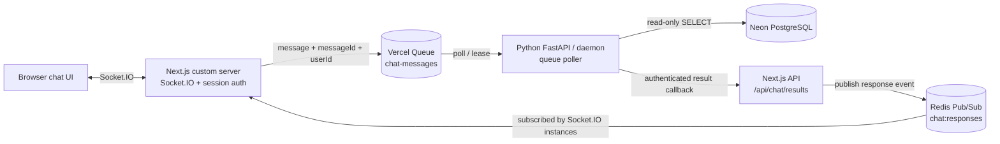

# Chat application architecture and technical design

**Status:** Current implementation plus planned text-to-SQL extension  
**Last updated:** 2026-11-02  
**Scope:** Next.js chat UI, Socket.IO, Vercel Queues, Python worker, PostgreSQL/Neon, and Redis response fan-out.

## 1. Executive summary

The application uses two transports because it has two different jobs:

- **Vercel Queues** carries work from the Next.js app to the Python worker. It buffers work, lets the worker process asynchronously, and retries failed deliveries.
- **Redis Pub/Sub** carries completed responses from Next.js to Socket.IO server instances for immediate delivery to connected browsers.

The current application has one queue topic (`chat-messages`) and one Redis channel (`chat:responses`). SQL messages are currently pasted directly into chat. The Python worker validates and executes read-only PostgreSQL queries, then returns a table response. Natural-language-to-SQL is a planned layer in front of the existing SQL executor; no model provider is selected or called yet.



## 2. Components and responsibilities

| Component | Responsibility | Current implementation |
|---|---|---|
| Browser UI | Sends text and renders acknowledgments and assistant responses | `components/chatbot/` listens for `chat:ack` and `chat:response` |
| Next.js custom server | Authenticates Socket.IO sessions, joins the user room, publishes inbound messages, and emits local socket events | `server.ts`, `lib/chat-socket.ts` |
| Queue producer | Sends a durable asynchronous job to the Python worker | `lib/chat-queue.ts`, topic `chat-messages`, idempotency key `messageId` |
| Vercel Queue | Retains work and supports consumer groups, leases, acknowledgment, and retry | Region `iad1`; local development uses the Python SDK devserver |
| Python worker | Polls the queue, validates the message, resolves direct SQL, executes it, and calls Next.js back | `python-worker/app/queue_worker.py` |
| SQL executor | Parses one query, runs it read-only with a timeout and bounded result count, maps values to UI-safe cells | `python-worker/app/sql_execution.py` |
| Callback route | Authenticates the worker, validates the response shape, and publishes it for delivery | `app/api/chat/results/route.ts` |
| Redis Pub/Sub | Fans each completed response out to connected Socket.IO server instances | `lib/chat-realtime.ts`, channel `chat:responses` |
| Neon PostgreSQL | Application data source for read-only analytics queries | `DATABASE_URL` is consumed by the Python worker only |

## 3. Message contracts

### Next.js to Python

The Socket.IO request is validated and enriched with the authenticated `userId` before it is placed on the queue:

```json
{
  "messageId": "stable-client-generated-id",
  "userId": "authenticated-user-id",
  "text": "SELECT 1 AS db_check;",
  "createdAt": "ISO-8601 timestamp"
}
```

The queue consumer group is `chat-python-worker`. Queue delivery is at-least-once, so handlers should be safe to retry. The producer uses `messageId` as an idempotency key. Queue acceptance is not the same as query completion or UI delivery.

### Python to Next.js

The worker calls `POST <NEXT_API_BASE_URL>/api/chat/results` with a bearer secret and a response envelope:

```json
{
  "userId": "authenticated-user-id",
  "messageId": "stable-client-generated-id",
  "response": {
    "type": "table",
    "title": "Query results",
    "columns": ["db_check"],
    "rows": [{"db_check": 1}]
  }
}
```

Supported UI response types include `text`, `table`, `chart`, `image`, and `video`. The callback route validates the envelope and response before broadcasting it.

## 4. End-to-end processing sequence

1. The browser opens Socket.IO at `/api/socket-io`. The server validates the chat session and joins the socket to a room named for the authenticated user.
2. The browser emits `chat:message` with `messageId` and text.
3. Next.js sends the message to `chat-messages`. `chat:ack accepted: true` means only that enqueue succeeded.
4. The Python worker polls the topic and receives the message under `chat-python-worker`.
5. If the text is direct SQL, the worker validates and executes it. Non-SQL text still follows the current demo response path.
6. The worker posts a result to the callback route. A `202 Accepted` means Next.js accepted the result for realtime delivery.
7. Next.js publishes the event to Redis channel `chat:responses` when Redis is configured. Socket.IO instances subscribe to that channel and emit `chat:response` to the matching user room. In local development without Redis, the callback emits directly through the local Socket.IO server.
8. The browser renders the response.

### Acknowledgment meanings

| Signal | What it confirms | What it does not confirm |
|---|---|---|
| `chat:ack accepted: true` | Next.js successfully enqueued the message | Python processed it, SQL ran, or the browser received a response |
| `chat.queue.message_received` | Python polled and started handling the message | Database connection or query success |
| `chat.sql.query_completed` with `responseType: "table"` | The query returned rows and the worker shaped a table response | Socket delivery to the browser |
| Callback HTTP `202` | Next.js accepted and emitted/published the result | A particular browser rendered it |
| Browser `chat:response` | The connected UI received the response event | Durable storage for future reconnects |

## 5. Why a queue for requests and Pub/Sub for responses

| Need | Vercel Queue | Redis Pub/Sub |
|---|---|---|
| Worker temporarily offline | Message remains available for later processing, subject to retention | A subscriber offline during publish misses the event |
| Retry after processing/callback failure | Queue lease expires and delivery can be retried | No built-in replay or retry |
| Background work and backpressure | Consumer can process asynchronously at its own pace | Broadcasts to active subscribers; it is not a work buffer |
| Send a result to several live Socket.IO instances | Possible, but a consumer and socket-routing step must be built | Direct broadcast to all active subscribers |
| Deliver a result after the browser disconnects | Possible only if the result is retained and later consumed or fetched | Not possible by Pub/Sub alone |

The request is work that must survive delays and worker restarts, so it uses a queue. The response is currently a live notification for an active socket, so Redis Pub/Sub is a small fan-out mechanism. Redis Pub/Sub is at-most-once; it is not the durable system of record. If chat history or delivery-after-reconnect becomes a requirement, persist results in PostgreSQL keyed by `messageId`/`userId`, and let the UI fetch missed results.

### Could a second response queue replace Redis?

Yes, but it only changes the response transport. A `chat-responses` queue would need a Next.js-side consumer to read each result and route it to the Socket.IO connection. If that connection is on another server instance, a shared realtime backplane or another routing mechanism is still needed. If the user is offline, the response also needs persistence and a reconnect fetch path. A second queue is justified when response processing needs durable independent consumers or retryable downstream work; it is not by itself a browser push transport.

## 6. Current SQL execution design

### Input and result path

- Direct messages beginning with `SELECT` or `WITH` are treated as SQL. A Markdown SQL fence is accepted.
- `sqlglot` parses the message as PostgreSQL and requires one query statement.
- `psycopg` connects using `DATABASE_URL` (or `NEON_DATABASE_URL` as a fallback).
- PostgreSQL executes in a read-only transaction with a 10-second statement timeout.
- The worker fetches up to 501 rows to detect overflow and returns at most 500 rows.
- Values that are not JSON table scalars are converted to strings; large cell values are truncated.
- SQL execution failures are returned to chat as text. The worker logs a PostgreSQL error event without logging the connection string or raw SQL.

Use schema-qualified names when the tables are in PostgreSQL schemas. For the supplied ER diagram, examples include `catalog.products`, `catalog.categories`, `sales.order_items`, and `app.customers`. The schema section labels should match the actual schema names in Neon.

### SQL safety boundary

Current behavior is deliberately read-only: only one parsed query is accepted and the database transaction is read-only. Use a dedicated Neon role granted only the `SELECT` permissions needed by the chat feature. Keep the statement timeout and row cap. SQL parsing and a read-only transaction are defense-in-depth; database privileges remain the primary permission boundary.

The worker opens a database connection per query today. If usage grows, add a bounded connection pool with connection lifetime/idle limits appropriate for Neon serverless connections. Do not put the database URL in browser variables or expose it to Next.js client code.

## 7. Planned natural-language-to-SQL extension

The existing resolver/executor seam is intended to support a translator later:

```mermaid
flowchart LR
  Text[Plain-language question] --> Context[Relevant schema + business definitions]
  Context --> Model[Configured model provider]
  Model --> SQL[Candidate SQL]
  SQL --> Validate[Parse + allowlist + read-only checks]
  Validate --> Execute[Existing PostgreSQL executor]
  Execute --> Shape[Table/chart response shaping]
  Shape --> Callback[Existing Next.js callback and socket delivery]
```



Recommended implementation stages:

1. Choose and configure a model provider in the Python worker; keep API credentials in local `.env` and Vercel environment settings, never in source control or browser code.
2. Give the model only the relevant table/column/relationship context and concise business definitions. Do not expose every customer field by default.
3. Ask the model for a structured result containing SQL and a short explanation, not executable arbitrary code.
4. Re-parse the generated SQL with the PostgreSQL dialect. Allow only one `SELECT` query; reject DDL, DML, multiple statements, and unsupported functions/features.
5. Execute with the same read-only DB role, timeout, and row cap. Return a clear text error when validation or execution fails.
6. Optionally show the generated SQL to the user for transparency. Never log sensitive prompt data or credentials.

The model provider is an open design choice in this document. The executor and response callback should remain provider-independent.

## 8. Runtime configuration

| Variable | Next.js local | Python local | Vercel Production |
|---|---|---|---|
| `CHAT_QUEUE_REGION` | `iad1` | `iad1` | Same region for producer/consumer |
| `VERCEL_QUEUE_BASE_URL` | `http://127.0.0.1:8111` | Same local URL | Unset; use hosted Vercel Queues |
| `VERCEL_QUEUE_TOKEN` | `local-token` for local queue server | Same local token | Unset; use Vercel runtime credentials/OIDC |
| `NEXT_CHAT_CALLBACK_SECRET` | Shared secret | Same secret | Same value in the shared Vercel project |
| `NEXT_API_BASE_URL` | Not used by Next producer | `http://localhost:3000` | Public/reachable Next.js deployment URL |
| `REDIS_URL` | Optional; omit/blank for direct local Socket.IO emit | Not used | Required by the Next.js realtime response path |
| `DATABASE_URL` | Not required | Real Neon PostgreSQL URL | Real Neon PostgreSQL URL for Python worker |
| `VERCEL_CLI_VERSION` | Local SDK compatibility detection used with the local broker | Not needed | Do not set as an app credential |

The real `DATABASE_URL` must replace the placeholders in the worker example. Keep `.env.local` and `python-worker/.env` out of Git. The Python worker does not need a copied, expiring Vercel token in production; it should use the Vercel runtime token source.

### Local processes

Run four processes: the local queue devserver on port 8111, the Next.js custom server on port 3000, the Python FastAPI/queue poller on port 8000, and a browser. The Python FastAPI lifespan starts the queue poller. `/health` confirms only that the Python HTTP process is alive; it does not test the queue or database.

The custom Node server loads Next environment files before dynamically importing the Socket.IO handlers because the queue client reads environment variables at module initialization (`server.ts`).

## 9. Deployment and versioning

- Deploy the monorepo as one Vercel project so the Next.js producer and Python daemon share project credentials and deployment scope.
- `vercel.json` declares the Python worker as the `chat-python-worker` daemon in `iad1`.
- In production, leave `VERCEL_QUEUE_BASE_URL` and `VERCEL_QUEUE_TOKEN` unset. Vercel Queues uses runtime credentials; do not copy short-lived tokens into persistent environment variables.
- The worker defaults to the current `VERCEL_DEPLOYMENT_ID`, matching producer isolation within the same deployment. `CHAT_QUEUE_DEPLOYMENT_ID` can explicitly override this. Local mode without a deployment ID polls all partitions.
- Queue delivery is at-least-once. Handlers and any future model calls should tolerate retries; use `messageId` for deduplication/idempotency where side effects are introduced.
- Redis must be reachable by the Next.js runtime. Each Socket.IO instance that should emit to local clients needs a live subscription to `chat:responses`.

## 10. Observability and troubleshooting

Logs are structured JSON and keyed by `messageId`:

| Event | Interpretation |
|---|---|
| `chat.socket.connected` | Browser socket authenticated and joined its user room |
| `chat.queue.publish_started` / `publish_succeeded` | Next.js attempted / completed queue publish |
| `chat.queue.message_received` | Python worker claimed the queued message |
| `chat.sql.query_detected` | Worker recognized direct SQL input |
| `chat.sql.query_completed` | Executor returned a UI response; inspect `responseType` (`table` means result rows) |
| `chat.sql.database_error` | PostgreSQL error class, SQLSTATE, and redacted detail are logged |
| `chat.callback.request_started` / `response_received` | Worker called Next.js and received an HTTP status |
| `chat.callback.validated` / `accepted` | Callback authenticated/validated and emitted or published the result |
| `chat.redis.subscribed` | Socket.IO server subscribed to response channel |
| `chat.redis.publish_completed` | Redis accepted response publish; inspect `subscriberCount` |
| `chat.socket.response_emitted` | A Socket.IO server emitted the response event to the user room |

Quick diagnosis:

- **No Python `message_received`:** verify Next.js and Python use the same queue region and, locally, the same queue base URL/token; verify deployment scope in Vercel.
- **Python received but no callback `202`:** check `NEXT_API_BASE_URL`, callback reachability, and the shared `NEXT_CHAT_CALLBACK_SECRET`.
- **Callback `202` but no UI response:** check `REDIS_URL`, `chat.redis.subscribed`, `subscriberCount`, authenticated user room, and browser `chat:response` listener. In local mode with Redis unset, inspect direct `chat.socket.response_emitted` logs.
- **`responseType: "text"` after a SQL query:** inspect `chat.sql.database_error` or the returned error text. Confirm `DATABASE_URL` is a real Neon URL and that the database role can read the qualified schema/table.
- **`/health` returns `ok`:** this proves only the API process is alive. It does not prove queue, callback, Redis, or database connectivity.

## 11. Decisions and alternatives

| Decision | Rationale | Trade-off |
|---|---|---|
| Vercel Queue for inbound chat work | Decouples request handling from slow Python/DB work and supports retries if the worker/callback fails | Adds asynchronous latency and requires message correlation/observability |
| Redis Pub/Sub for live responses | Low-friction fan-out to active Socket.IO instances | Ephemeral; no replay or delivery guarantee for offline clients |
| Python owns SQL and DB credentials | Keeps database access and future model logic server-side in one worker | Adds a separate runtime/service to configure and monitor |
| Dedicated read-only SQL path | Supports the current manual-query phase while containing database authority | Does not yet translate natural language; DB grants and query limits remain essential |
| Keep response transport separate from work queue | A queue is the work buffer; Pub/Sub is live fan-out | Two services to configure; a second queue is an option if durable response processing becomes a requirement |

## 12. References

- [Vercel Queues concepts: durability, consumer groups, retries, and delivery](https://vercel.com/docs/queues/concepts)
- [Vercel Queues poll mode](https://vercel.com/docs/queues/poll-mode)
- [Redis Pub/Sub delivery semantics and use cases](https://redis.io/docs/latest/develop/use-cases/pub-sub/)
- [Vercel OIDC federation](https://vercel.com/docs/oidc)
- Repository implementation: `lib/chat-queue.ts`, `lib/chat-realtime.ts`, `lib/chat-socket.ts`, `app/api/chat/results/route.ts`, `python-worker/app/queue_worker.py`, `python-worker/app/sql_execution.py`, and `vercel.json`.
